# concept-illustration

An agent skill that turns ideas into richly detailed isometric illustrations that move.

Ask your coding agent to *"illustrate how our cache works"* or *"make a hero animation for the landing page"*. It decides what the picture should say and how it should look for that subject, writes a short scene script, and the bundled engine draws and animates it. You get one self-contained animated SVG that plays anywhere, and optionally an interactive, step-through version.

<p align="center">
  
</p>

## Install

```bash
npx skills add MuhammadSadeeq/concept-illustration
```

Works with any agent that supports skills. The only requirement is Node.js 18 or newer; there is nothing else to install.

## What it makes

Every image below is a single SVG file animated with plain CSS. No JavaScript runs on the page. Each was art-directed for its subject: no two share a look.

<table>
  <tr>
    <td width="50%"><br><sub><b>End-to-end encryption</b> · abyss palette, ring floor</sub></td>
    <td width="50%"><br><sub><b>Fresh bread, delivered</b> · lemon palette, flat finish, custom oven and loaf</sub></td>
  </tr>
  <tr>
    <td><br><sub><b>From order to doorstep</b> · sand palette on a raised plate</sub></td>
    <td><br><sub><b>How an AI agent works through a task</b> · plum palette, soft finish</sub></td>
  </tr>
  <tr>
    <td><br><sub><b>Compound interest</b> · sky palette, growth recipe</sub></td>
    <td><br><sub><b>Photosynthesis</b> · mint palette</sub></td>
  </tr>
  <tr>
    <td><br><sub><b>From commit to production</b> · paper palette, outline finish</sub></td>
    <td><br><sub><b>From beginner to expert</b> · blueprint palette</sub></td>
  </tr>
  <tr>
    <td><br><sub><b>Load balancing</b> · carbon palette</sub></td>
    <td><br><sub><b>Build, measure, learn</b> · sunset palette, flat finish</sub></td>
  </tr>
</table>

## Mechanisms, not only diagrams

Sometimes the clearest picture of an idea is one small machine doing one thing. A vignette has a single object and no labels; its parts act the idea out. Parts slide, lift, turn, wait and hold on one shared clock, with weight and easing.

<table>
  <tr>
    <td width="33%"><br><sub><b>Approval</b> · studio palette, hairline finish</sub></td>
    <td width="33%"><br><sub><b>Routing</b> · sand palette, soft finish</sub></td>
    <td width="33%"><br><sub><b>Keeping watch</b> · abyss palette, ring floor</sub></td>
  </tr>
</table>

### Working models

Put a mechanism into a labelled scene and you get a model that teaches. Here the coil's sides really circle the shaft, the current in the wires reverses every half turn, the lamp is brightest when the coil lies level and the meter swings in step, because every part shares one clock and the phases come from the physics.

<p align="center">
  
</p>

The same goes for anything made of many small things in motion. Below, each particle of air only rocks to and fro, a little later than its neighbour, and the squeeze travels although no particle does. One line of scene script draws a whole row of them.

<p align="center">
  
</p>

## One scene, many looks

A look is three independent choices: a **palette** (22 built in, or any brand colours), a **finish** (solid, soft, outline, hairline, flat, neon) and a **floor** (grid, dots, a raised plate, rings, none). Every combination is coherent because all tones are derived from the palette in a perceptual colour space. There is no default look: the skill directs the agent to choose for the subject, and a scene that chooses nothing gets one picked from its title.

<table>
  <tr>
    <td></td>
    <td></td>
    <td></td>
  </tr>
  <tr>
    <td></td>
    <td></td>
    <td></td>
  </tr>
  <tr>
    <td></td>
    <td></td>
    <td></td>
  </tr>
</table>

`--looks` renders a scene in several looks side by side so the choice can be made by eye.

## How it works

The agent does not draw. It decides what the picture says, then describes it:

```js
export default ({ scene }) => {
  const s = scene({ look: 'ocean', floor: 'plate', title: 'How a cache speeds up a website' });

  const user   = s.add('laptop',   { at: [0, 0],   label: 'Visitor', ui: 'image' });
  const cache  = s.add('server',   { at: [4.5, 0], label: 'Cache', hero: true });
  const origin = s.add('database', { at: [9, 0],   label: 'Origin' });

  s.link(user, cache);
  s.link(cache, origin, { style: 'dashed' });

  s.story([
    s.say('A visitor asks for a page'),
    s.send(user, cache),
    s.say('The cache fetches it once'),
    s.send(cache, origin),
    s.send(origin, cache, { as: 'doc' }),
    s.tint(cache, 'ok'),
    s.say('and answers everyone after that'),
    s.send(cache, user, { as: 'doc' }),
    s.mark(user, 'check'),
    s.wait(1),
  ]);
  return s;
};
```

```bash
node skills/concept-illustration/scripts/build.mjs cache.scene.mjs --sheet
```

The engine takes it from there:

- **Geometry and light.** True isometric projection, exact depth ordering, three-tone shading, a contact shadow and a cast shadow that follow each object's real footprint, rim light, depth haze.
- **Detail.** Sockets where links start, trails behind moving tokens, bursts on state badges, motes of light around a glowing hero, blinking status lights, glare and live content on screens.
- **Layout.** Connectors route along the floor grid and stop where an object's outline begins. Labels pick the side with room. The frame crops to the content.
- **Motion.** A story of cause and effect compiles to CSS keyframes. Tokens pass correctly behind and in front of objects. Loops close exactly, so exported video and GIFs never jump.
- **A checker.** Every build reports collisions, hidden links, overlapping labels, crowding and missing focus, each with the fix.
- **Proof, not eyeballing.** Whether a current flows the right way or a caption arrives with the thing it describes is not something a layout checker can know. So the build can print what moves, when and which way in plain words; review sheets can show chosen moments close up with motion trails; and a scene can state facts about its own motion (`s.expect(3, at => at('electron').x < 0)`) that the build verifies with the same arithmetic the browser uses.

## Not limited to the kit

Fifty objects and ninety-five icons cover a lot, and the skill tells the agent to go past them whenever the subject needs it:

- **Any object.** `s.define` builds new objects from the same shapes the kit uses (blocks, cylinders, extrusions, cones, spheres, artwork on faces). The bakery scene above defines its own oven and loaf in twenty lines.
- **Any mechanism.** Parts of an object can slide, lift, swing, orbit an axis and run keyframed sequences of their own, which is how the vignettes and the generator above are made. Streams of particles, vector arrows, ripples, gauges and changing readouts are ready-made.
- **Any drawing.** `s.svg` stands arbitrary SVG artwork in the scene.
- **Real movement.** Objects slide, rise out of the floor, lift, appear and change state; tokens can be any object; the camera can move in on a detail and back out. Objects can also be translucent, or ghosted to stand for something planned or missing.
- **Sets that match.** A series file holds the look, the image size and the custom objects for a whole course or product, so forty illustrations read as one work.
- **Experiences.** `--experience step` produces an interactive page where a reader walks through the story one caption at a time; `scroll` ties it to the page scroll; objects answer a hover or tap with a detail card. Open [`gallery/request-lifecycle.experience.html`](gallery/request-lifecycle.experience.html) locally to try one.

## Built to work with small models

Good illustration needs judgement that small models do not reliably have. The skill moves the mechanical judgement into the engine and spends the instructions on the decisions that matter: what the picture claims, what it should feel like, which object is the hero, what happens in what order.

- **Recipes** for seven common shapes (pipeline, hub, layers, cycle, fan-out, growth, steps) turn a ten-line config into a finished scene.
- **Forgiving input.** Near-miss option names are accepted, typos get a "did you mean", and errors name the line.
- **Tested the hard way.** Unseen briefs, from OAuth to vaccines to a farm's delivery flow, were given to a small, fast model with nothing but this skill. Every run ended in a finished scene with a clean report, nearly all at the first build, including ones with custom-built objects and an interactive walk-through. Whatever tripped them up was fed back into the instructions and the engine.

## The kit

<p align="center"></p>

## Output

| File | Use |
| --- | --- |
| `name.svg` | The deliverable. Animates in ``, inline, in Markdown and in READMEs. Honours reduced-motion settings |
| `name.experience.html` | Optional interactive page: step-through, scroll-driven, hover details |
| `name.html` | A preview with play, pause and scrub |
| `name.sheet.png` · `name.looks.png` | Key frames of the loop, and the scene in several looks, for review |
| `name.png` · `name.mp4` · `name.gif` · `name.webm` | Optional exports (need a Chrome-family browser; video needs ffmpeg) |

A small transparent component for a feature card is the same thing with `background: false`:

<p align="center"></p>

## Repository layout

```
skills/concept-illustration/
  SKILL.md            what the agent reads first
  references/         design guide, custom objects, checking, API, kit, recipes, delivery
  examples/           finished scenes, one per pattern
  scripts/            the engine (zero dependencies), build and render commands
gallery/              built examples used in this README
dev/                  tests and the gallery builder
```

## Development

```bash
npm test             # examples, every object, every look, error messages
npm run gallery      # rebuild gallery/ from the examples
npm run list         # print every object, icon, look, token and recipe
```

## Versions

See [CHANGELOG.md](CHANGELOG.md). To install a fixed version: `npx skills add MuhammadSadeeq/concept-illustration@v1.1.0`.

## License

MIT
