# concept-illustration

An agent skill that turns ideas into polished isometric illustrations that move.

Ask your coding agent to *"illustrate how our cache works"* or *"make a hero animation for the landing page"*. It writes a short scene script, the bundled engine draws and animates it, and you get one self-contained animated SVG that plays anywhere: web pages, docs, READMEs, slides, video.

<p align="center">
  
</p>

## Install

```bash
npx skills add MuhammadSadeeq/concept-illustration
```

Works with any agent that supports skills. The only requirement is Node.js 18 or newer; there is nothing else to install.

## What it makes

Every image below is a single SVG file animated with plain CSS. No JavaScript runs on the page.

<table>
  <tr>
    <td width="50%"><br><sub><b>How an AI agent works through a task</b> · clay theme</sub></td>
    <td width="50%"><br><sub><b>End-to-end encryption</b> · aurora theme, custom accent</sub></td>
  </tr>
  <tr>
    <td><br><sub><b>From order to doorstep</b> · sunset theme</sub></td>
    <td><br><sub><b>Compound interest</b> · growth recipe</sub></td>
  </tr>
  <tr>
    <td><br><sub><b>From commit to production</b> · paper theme, pipeline recipe</sub></td>
    <td><br><sub><b>Layers of a web application</b> · layers recipe</sub></td>
  </tr>
  <tr>
    <td><br><sub><b>Load balancing</b> · carbon theme, fan-out recipe</sub></td>
    <td><br><sub><b>From beginner to expert</b> · blueprint theme, steps recipe</sub></td>
  </tr>
  <tr>
    <td><br><sub><b>Photosynthesis</b> · clay theme, green accent</sub></td>
    <td><br><sub><b>Build, measure, learn</b> · cycle recipe</sub></td>
  </tr>
</table>

## How it works

The agent does not draw. It decides what the picture says, then describes it:

```js
export default ({ scene }) => {
  const s = scene({ theme: 'aurora', title: 'How a cache speeds up a website' });

  const user   = s.add('laptop',   { at: [0, 0],   label: 'Visitor' });
  const cache  = s.add('server',   { at: [4.5, 0], label: 'Cache', hero: true });
  const origin = s.add('database', { at: [9, 0],   label: 'Origin' });

  s.link(user, cache);
  s.link(cache, origin, { style: 'dashed' });

  s.story([
    s.say('A visitor asks for a page'),
    s.send(user, cache),
    s.say('The cache fetches it once'),
    s.send(cache, origin),
    s.send(origin, cache, { as: 'doc' }),
    s.tint(cache, 'ok'),
    s.say('and answers everyone after that'),
    s.send(cache, user, { as: 'doc' }),
    s.mark(user, 'check'),
    s.wait(1),
  ]);
  return s;
};
```

```bash
node skills/concept-illustration/scripts/build.mjs cache.scene.mjs --sheet
```

The engine takes it from there:

- **Geometry and light.** True isometric projection, exact depth ordering, three-tone shading derived in a perceptual colour space, soft or cast shadows, rim highlights.
- **Layout.** Connectors route along the floor grid and stop where an object's outline begins. Labels pick the side with room. The frame crops to the content.
- **Motion.** A story of cause and effect compiles to CSS keyframes. Tokens pass correctly behind and in front of objects. Loops close exactly, so exported video and GIFs never jump.
- **A checker.** Every build reports collisions, hidden links, overlapping labels, crowding and missing focus, each with the fix, so an agent can correct its own work without seeing it.

## Built to work with small models

Good illustration needs judgement that small models do not reliably have. The skill moves that judgement into the engine and leaves the model the part it can do: naming the actors and the order of events.

- **Recipes** for the seven shapes most ideas have (pipeline, hub, layers, cycle, fan-out, growth, steps) turn a ten-line config into a finished, animated scene.
- **Seven tuned themes** make colour a one-word decision, and a brand accent is one option.
- **Fifty objects and ninety-five icons** cover most nouns without any drawing.
- **Forgiving input.** Near-miss option names are accepted, typos get a "did you mean", and errors name the line.
- **Tested the hard way.** Seven unseen briefs, from OAuth to vaccines to a bakery's delivery flow, were given to a small, fast model with nothing but this skill. All seven built clean on the first attempt; their feedback shaped the instructions you see here.

## Themes

<table>
  <tr>
    <td></td>
    <td></td>
    <td></td>
  </tr>
  <tr>
    <td></td>
    <td></td>
    <td></td>
  </tr>
</table>

Plus `mono`, black line on white, for print and long documents.

## The kit

<p align="center"></p>

## Output

| File | Use |
| --- | --- |
| `name.svg` | The deliverable. Animates in ``, inline, in Markdown and in READMEs. Honours reduced-motion settings |
| `name.html` | A preview with play, pause and scrub |
| `name.sheet.png` | Key frames of the loop on one sheet, for review |
| `name.png` · `name.mp4` · `name.gif` · `name.webm` | Optional exports (need a Chrome-family browser; video needs ffmpeg) |

A small transparent component for a feature card is the same thing with `background: false`:

<p align="center"></p>

## Repository layout

```
skills/concept-illustration/
  SKILL.md            what the agent reads first
  references/         API, kit, recipes, design guide, delivery guide
  examples/           twelve finished scenes, one per pattern
  scripts/            the engine (zero dependencies), build and render commands
gallery/              built examples used in this README
dev/                  tests and the gallery builder
```

## Development

```bash
npm test             # every example, every object in every theme, error messages
npm run gallery      # rebuild gallery/ from the examples
npm run list         # print every object, icon, theme, token and recipe
```

## License

MIT
